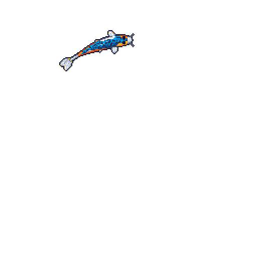

<!-- SECTION 1: HEADER & INTRO -->
# Hey there! I'm Kannikadevi 👋

> A passionate Pre-Final Student building scalable applications and exploring new technologies.
> Love to Explore New Tech 
---

---
<!-- SECTION 2: ABOUT ME -->
## About Me

* 🚀 **What I Do:** I build software solutions focusing on  Web Development, Machine Learning.
* 🌱 **Currently Learning:** Deepening my knowledge in  React, Data Structures and FastAPI.
* 🎯 **Current Focus:** Working on ML projects and strengthening core programming fundamentals.
* ⚡ **Hobbies & Interests:** When I'm not coding, you can find me reading tech blogs, Self-Help Books and watching SCI-FI movies!!.

---

<!-- SECTION 3: TECH STACK -->
## 💻 Tech Stack

### Languages

### Frameworks & Tools

---

<!-- SECTION 4: CONNECT WITH ME -->
## 🌐 Connect With Me

  
 
 
  

